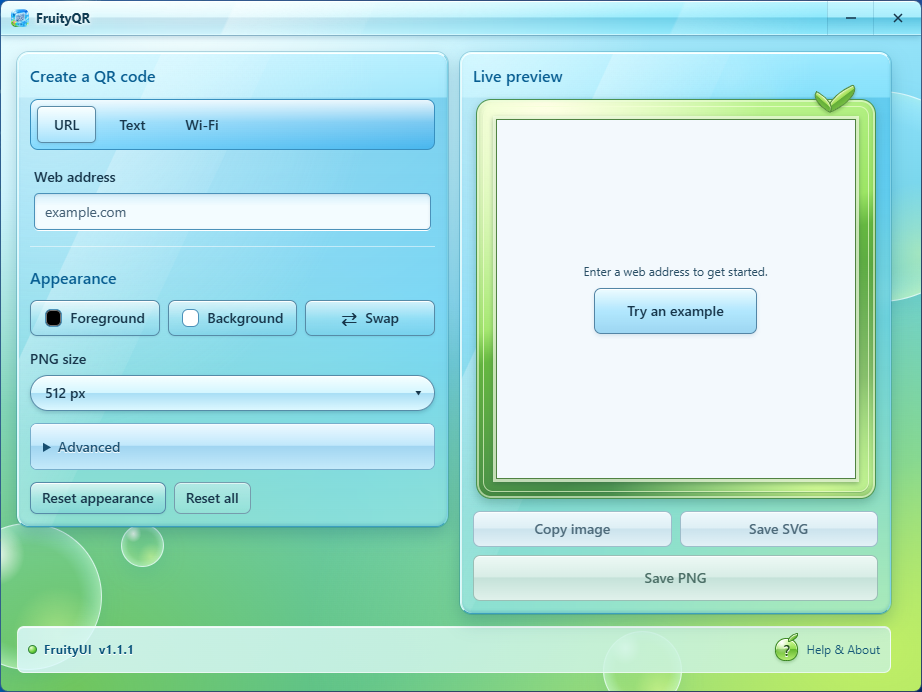

# FruityQR v1.0

An offline desktop QR code generator with **Frutiger Aero** styling.

FruityQR brings a familiar task to the Fruity Suite with glossy glass panels,
soft bubbles, and a leafy green frame around the live preview.

<p align="center">
  
</p>

<p align="center">
  <a href="https://github.com/kapsaloco/FruityQR/releases">Downloads &amp; Releases</a>
</p>

Turn a link, a note, or Wi-Fi network details into a QR code. Copy the result
or save it as a PNG or SVG.

## Features

- Generate QR codes for web addresses, text, and Wi-Fi networks.
- Preview changes as you type. Bare web addresses use HTTPS by default.
- Choose and swap foreground and background colors, with warnings for inverted
  colors or low contrast.
- Set the PNG size and adjust the quiet zone and error correction under
  **Advanced**.
- Copy the QR image or save a PNG or scalable SVG.

## Usage

1. Select **URL**, **Text**, or **Wi-Fi** and enter the content.
2. Check the live preview. Adjust the colors or open **Advanced** for more
   control.
3. Select **Copy image**, **Save SVG**, or **Save PNG**.

Select **Try an example** in the empty URL preview to generate a sample code.

## Privacy

FruityQR works locally without an account or network service. Your input stays
on your device. Anyone who scans a Wi-Fi QR code can read the network details
encoded in it.

The Windows app uses the Microsoft Edge WebView2 runtime.

## Development

FruityQR uses Tauri, Vite, and vanilla TypeScript.

```sh
npm ci
npm test
npm run tauri dev
```

## FruityUI

This repo carries FruityUI 1.1.1. For another Fruity app, copy
[`src/styles/fruity/`](src/styles/fruity) and follow the
[integration guide](src/styles/fruity/README.md). The shared directory contains
the library, its license, and its [changelog](src/styles/fruity/CHANGELOG.md).

Build the interactive offline showcase with `npm run build:showcase` and open
`dist-showcase/offline/v1.1/fruity.html` in a browser. The
[showcase guide](showcase/README.md) describes how to carry the demos forward.

## License

FruityQR is available under the [MIT License](LICENSE). FruityUI includes its
own [MIT license file](src/styles/fruity/LICENSE) for reuse in other apps.
Third-party dependencies retain their own licenses.
